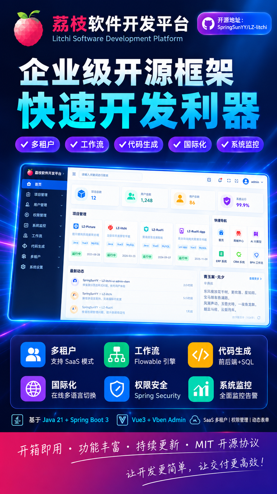
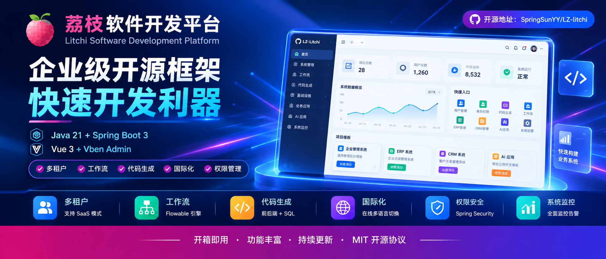

# LZ-Litchi荔枝软件开发平台：让企业软件开发有一个更好的起点

　　**LZ-Litchi荔枝软件开发平台**是一个基于Java 21、Spring Boot 3和Vue 3构建的开源企业级软件开发平台。项目以企业应用开发为核心，将系统管理、权限控制、代码生成、工作流等通用能力整合到统一的平台中，同时探索ERP、CRM、AI应用等业务场景，帮助开发者减少重复建设，把更多精力放在具体业务需求上。

　　开发这个项目，并不是为了再做一个简单的后台管理模板，而是希望搭建一套能够持续扩展的开发基础。无论是开发一套企业内部管理系统，还是逐步构建包含订单、客户、流程和智能应用的业务平台，都可以从现有基础能力出发，根据实际需求进行调整和扩展。

## 一、为什么要开发LZ-Litchi？

　　在企业软件开发过程中，很多项目虽然业务不同，但底层需要解决的问题往往比较相似。例如，用户与角色管理、菜单权限、数据维护、文件上传、定时任务以及操作日志等，几乎是许多管理系统都会涉及的基础功能。

　　如果每次开发新项目，都从这些功能开始重新实现，不仅会增加开发工作量，也容易造成不同项目之间的代码风格和实现方式不一致。即使使用现成的后台模板，也通常需要根据实际业务继续补充权限、流程、基础服务和业务模块。

　　**LZ-Litchi希望解决的，就是这些通用能力反复建设的问题。**

​       通过将基础功能、开发工具和业务应用组织在一个统一的平台中，让开发者能够在已有基础上开展工作，而不是每次都从零开始搭建系统。

　　当然，通用平台并不意味着所有企业都应该使用完全相同的业务流程。不同企业在订单处理、客户管理、生产协同等方面存在各自的规则，真正需要复用的是成熟的基础能力，而不是把所有业务都限制在固定的模式里。

## 二、LZ-Litchi有哪些核心能力？

　　**LZ-Litchi**的能力可以分为两个层次：一类是为各类企业应用提供支撑的通用基础能力，另一类是面向具体业务需求构建的业务模块和应用能力。前者解决系统如何管理、如何开发的问题，后者则用于承载实际业务。

### 1. 通用基础能力：为业务系统提供统一底座

　　在系统管理方面，平台围绕用户、角色、菜单、权限等常见需求提供基础能力，便于开发者建立统一的访问控制和管理机制。对于需要长期维护的企业系统来说，这些功能不仅是项目上线前的基础配置，也是后续人员调整、权限变化和业务扩展时的重要支撑。

　　在开发效率方面，平台整合代码生成、国际化、定时任务、系统监控等常见能力，减少重复编写基础代码的工作。开发者可以把更多时间投入业务模型设计、流程梳理和实际功能实现，而不是反复处理相似的基础需求。

　　此外，工作流、文件服务等能力也能够为复杂业务提供支撑。例如，当一项业务需要经过提交、审核、处理和归档等环节时，可以结合具体规则设计相应流程，而不必简单地将所有状态变化都写死在业务代码中。

### 2. 业务与应用能力：从基础平台走向实际场景

　　基础平台解决的是通用问题，但企业最终需要的仍然是能够处理实际业务的系统。因此，LZ-Litchi也围绕ERP、CRM等企业应用方向进行扩展，探索订单管理、客户管理以及业务流程协同等场景。

　　这些业务能力并不意味着每个项目都必须完整采用某一套模块。对于业务相对简单的企业，可以优先构建所需的管理功能；对于流程更复杂的项目，则可以在基础能力之上逐步完善业务模块，按照实际需求组织系统。

　　平台也涉及AI应用方向，包括结合图像特征提取与向量检索技术探索以图搜图等功能。这类能力可以用于商品图片检索、图片资源管理等场景，但具体效果仍然取决于数据质量、模型选择和业务使用方式。

　　**LZ-Litchi的重点不是把所有功能堆积在一起，而是让通用基础能力与具体业务需求能够在同一个开发体系中协同工作。**

## 三、这些能力可以用来做什么？

　　以一个需要管理订单、客户资料和业务处理进度的企业系统为例，开发者可以先利用平台的用户权限、菜单管理和基础服务搭建系统框架，再根据实际业务设计订单信息、客户资料以及各环节的处理规则。如果订单还需要经过审核、分配和后续处理，也可以结合工作流或业务状态管理实现相应的过程控制。

　　在这个过程中，基础平台负责提供通用支撑，业务模块负责表达具体规则。企业可以根据自身情况确定哪些功能需要保留、哪些流程需要调整，而不是为了适应软件而改变原有业务逻辑。

　　对于开发团队而言，这种方式也有助于减少项目之间的重复劳动。当后续需要增加报表、文件管理或新的业务模块时，可以优先评估现有能力是否适用，再决定复用、调整还是重新实现，从而让开发工作更加聚焦。

　　需要说明的是，这里描述的是平台在实际项目中的一种应用思路，并非特定客户已经落地并取得量化成果的案例。具体项目仍然需要结合业务流程、数据结构和使用要求进行设计。

## 四、技术选型与开源价值

　　**LZ-Litchi**采用Java 21、Spring Boot 3、Vue 3、TypeScript和Vite等技术构建前后端应用。后端与前端分别承担业务处理和交互展示职责，开发者可以根据项目需要对模块进行调整，也可以结合自身技术栈继续完善应用。

　　选择这些技术，不只是为了追求较新的版本，更重要的是建立一套便于开发、维护和持续演进的技术基础。对于需要长期迭代的企业软件来说，代码结构是否清晰、功能边界是否合理，以及后续开发人员能否理解和接手，往往比单纯增加功能更重要。

　　作为开源项目，LZ-Litchi也希望让更多开发者能够直接了解项目的实现方式，在实际使用中进行学习、修改和扩展。相比只提供界面展示的模板，能够持续查看和调整源码，意味着开发者可以根据自己的业务需要掌握系统的具体实现，而不是只能在既定功能范围内进行配置。

## 五、从LZ-Litchi开始构建自己的应用

　　LZ-Litchi适合希望减少基础功能重复开发的Java开发者、需要搭建企业管理系统的开发团队，以及希望在现有技术基础上逐步扩展业务能力的项目。它可以作为新项目的开发起点，也可以作为研究企业级应用架构、权限设计和业务模块组织方式的参考。

　　不过，开源平台并不能直接替代业务分析。真正开始一个项目之前，仍然需要明确要解决的问题、梳理业务流程、确定数据关系，并评估现有模块是否符合实际需求。只有把平台能力与业务目标结合起来，才能避免从重复造轮子走向盲目堆砌功能。

　　如果你正在寻找一套可以研究、修改和扩展的企业级软件开发基础，可以进一步了解**LZ-Litchi**。

- **项目源码：**https://github.com/SpringSunYY/LZ-litchi
- **在线演示：**[https://www.litchi.work](https://www.litchi.work/)
- **演示视频：**https://www.bilibili.com/video/BV1RR7N6QEZo

　　LZ-Litchi希望提供的，不是一套要求所有项目照搬的固定方案，而是一个能够继续开发、持续调整的起点。开发者可以在现有基础上构建自己的业务应用，让更多精力回到真正需要解决的问题上。