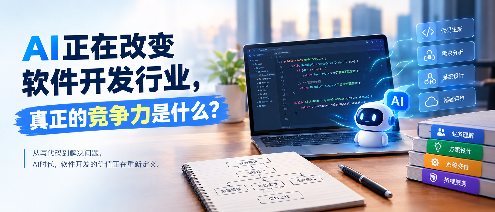
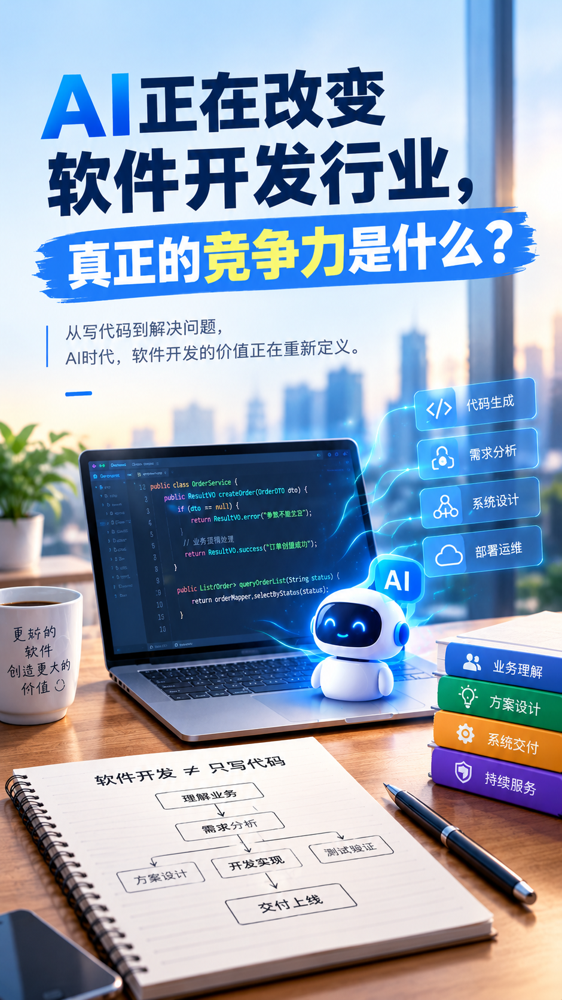

# AI正在改变软件开发行业，真正的竞争力是什么？

　　过去，开发一套软件往往需要经历需求分析、页面设计、编写代码、测试和部署等多个环节。对于企业来说，软件开发不仅意味着资金投入，也意味着需要花费时间反复沟通需求、调整功能，最终才能让系统真正投入使用。

　　但随着AI编程工具不断发展，软件开发的工作方式正在发生变化。开发者可以借助AI生成代码、编写接口、构建页面，甚至完成部分原本需要大量人工参与的开发任务。一些过去需要花费较长时间完成的工作，现在已经能够明显加快。

　　这让软件开发行业面临一个值得思考的问题：

> **当AI越来越擅长编写代码，开发者和软件开发公司的竞争力究竟在哪里？**

　　如果软件开发的全部价值只是把需求转换成代码，那么随着AI能力不断增强，单纯依靠编码速度建立的优势确实可能逐渐缩小。但真实的软件项目并没有这么简单，尤其是企业管理系统，它面对的不是一道有标准答案的编程题，而是一个需要被理解、梳理和解决的业务问题。

## 一、AI正在改变软件开发，已经不只是提高编码效率

　　过去，软件开发需要投入大量时间完成重复性的工作。例如，开发一个管理系统时，开发者需要编写大量增删改查接口、设计数据表、编写前端页面、处理表单校验，以及不断排查运行过程中出现的问题。这些工作虽然必不可少，但其中相当一部分具有重复性，也需要开发者花费大量时间。

　　现在，AI正在改变这些工作的完成方式。开发者可以让AI辅助编写代码、解释复杂逻辑、生成测试用例，或者根据明确的需求生成页面和接口。配合合适的开发工具，AI还可以参与多个开发环节，帮助开发者更快地完成从需求描述到功能实现的过程。

　　这意味着，软件开发的效率有机会得到进一步提升。对于企业来说，部分软件功能的实现成本可能因此降低，一些过去因为开发周期长、预算有限而暂时搁置的需求，也有机会更快地进行验证和落地。

　　但我们也需要看到，**开发效率提高，并不等于整个软件项目的成本会按照相同比例下降。** 软件项目除了编写代码，还涉及需求沟通、业务流程设计、系统集成、测试验证、数据迁移和后期维护。AI能够帮助完成其中一部分工作，却不能自动保证整个项目的方向正确、结果可靠。

　　因此，AI带来的变化并不只是让开发者写代码更快，而是让软件开发过程中不同工作的时间分配和价值构成发生变化。过去可能需要投入大量时间实现的功能，现在有机会更快完成；而那些决定软件是否真正解决问题的工作，依然需要得到足够重视。

## 二、当写代码越来越容易，真正困难的事情是什么？

　　要理解这一点，我们可以从企业开发管理系统的实际需求来看。

　　假设一家企业准备开发一套订单管理系统。企业提出的需求可能包括订单录入、状态修改、图片上传、数据查询和打印管理。对于熟悉软件开发的人来说，这些功能并不陌生，AI也可以帮助开发者快速生成相应的页面、接口和数据库操作。

　　但如果进一步了解企业的实际业务，就会发现问题远不止这些功能本身。

> 订单创建之后应该进入什么状态？
>
> 哪些订单需要优先处理？
>
> 订单图片与排版文件之间是什么关系？
>
> 打印完成之后由谁确认？
>
> 出现售后问题时，原来的订单记录应该如何保留？

​       这些问题如果没有提前梳理清楚，开发者即使很快完成了所有页面，也不一定能让系统真正符合企业的工作方式。　　

​       更复杂的是，不同企业的业务规则往往存在差异。即使两家企业都需要订单管理系统，它们的订单来源、审批流程、生产环节、权限划分和异常处理方式也可能完全不同。通用软件可以提供基础能力，但具体业务如何运转，仍然需要根据企业自身情况进行分析。

　　**真正困难的地方，往往不是如何实现一个功能，而是判断应该实现什么功能，以及这些功能之间应该形成怎样的关系。**

　　这也是为什么软件开发不能只停留在需求清单上。客户说需要一个订单查询页面，背后可能是订单越来越多，员工难以快速定位记录；客户说需要增加一个状态字段，背后可能是原有流程无法反映真实的业务进度。如果只按照表面需求逐项开发，就容易不断增加功能，却没有从根本上改善工作效率。

　　AI能够帮助开发者分析需求、提出方案，但需求是否完整、业务规则是否准确、方案是否适合实际工作，仍然需要结合具体场景进行判断。开发者需要做的，不只是把客户说出来的需求转换成代码，还要理解这些需求为什么存在，以及它们真正想解决什么问题。

## 三、为什么AI生成了代码，软件却不一定能解决问题？

　　对于企业而言，一套软件能否运行，只是最基本的要求。真正重要的是，员工能否使用它完成工作，管理者能否通过它了解业务情况，以及系统能否在业务发生变化时继续发挥作用。

　　这也是AI编程容易被误解的地方。当我们看到AI能够快速生成一个页面、一个接口，甚至一个可以演示的应用时，很容易认为软件开发已经变得非常简单。但一个演示程序能够运行，与一套软件能够长期支撑企业业务，是两个不同层面的事情。

　　例如，AI可以帮助生成订单录入功能，但如果没有考虑重复提交、异常数据、权限控制和历史记录，系统在实际使用中仍然可能出现问题。AI也可以帮助生成数据查询功能，但如果订单、图片和处理记录之间的关联没有设计清楚，员工依然可能需要在不同页面、文件夹和表格之间反复查找信息。

　　这些问题并不意味着AI没有价值，而是说明软件开发的质量取决于整个解决过程，而不仅仅取决于代码生成的速度。需求是否明确、业务规则是否完整、设计是否合理、测试是否充分，以及系统上线后是否能够持续维护，都会影响最终结果。

　　与此同时，AI生成的代码也需要经过验证。对于涉及财务数据、客户信息、业务权限和关键流程的系统，开发者不能因为代码是AI生成的，就默认它一定正确。必要的测试、安全检查和人工审核，仍然是软件交付过程中不可缺少的环节。

　　**如果一开始就没有理解清楚业务问题，AI可能只是帮助我们更快地完成一个不合适的方案。** 反过来，如果问题已经梳理清楚，业务规则也比较明确，那么AI就有机会成为提高开发效率、降低重复劳动的重要工具。

　　因此，AI编程真正需要解决的，不只是如何更快地生成代码，而是如何与需求分析、方案设计、测试验证和实际业务结合起来，让开发效率的提升最终转化为软件质量和业务效率的改善。

## 四、AI时代，软件开发的竞争力正在发生什么变化？

　　当AI逐渐承担越来越多的编码工作时，开发者之间的差异可能会发生变化。过去，熟练掌握编程语言、开发框架和常见技术方案，能够帮助开发者建立一定的竞争优势。但当AI能够辅助完成更多标准化的开发任务时，仅仅依靠熟悉某种技术、能够快速编写代码，可能越来越难以形成长期优势。

　　这并不是说技术能力不再重要。相反，开发者仍然需要理解代码、掌握系统设计、判断技术方案是否合理，并能够识别AI生成结果中的错误。区别在于，技术能力的价值不应该只体现在亲自编写了多少代码，而应该体现在能否借助技术和工具，可靠地解决实际问题。

　　首先，**理解业务的能力会变得更加重要。** 开发者需要知道客户真正想解决什么问题，现有工作流程为什么效率低，以及不同业务环节之间存在怎样的关联。只有理解这些内容，才能把模糊的需求转化为清晰、可执行的方案。

　　其次，方案设计与系统整合能力同样重要。真实的企业软件很少是孤立存在的，它可能需要连接现有的管理系统、文件资源、打印设备或第三方服务。单独生成一个功能并不难，但如何让多个功能协同工作，如何处理异常情况，以及如何确保数据准确，都需要系统性的考虑。

　　最后，交付和持续服务能力也值得重视。软件不是上线之后就不再变化的产品，企业的业务流程、管理要求和使用习惯都可能发生调整。能够持续理解需求、修正问题、维护系统，并根据实际情况改进方案，才能让软件长期产生价值。

　　对于软件开发公司来说，这种变化同样值得关注。AI可能让部分开发任务变得更高效，但客户最终需要的仍然是能够解决问题的服务。如果一家公司的优势仅仅是用较低价格、更快速度完成代码编写，那么它可能更容易受到工具进步和市场竞争的影响。相反，如果它能够理解特定行业的业务特点，形成成熟的解决思路，并对最终交付负责，就有机会建立更有价值的竞争优势。

　　**AI正在改变软件开发的工作方式，但竞争力的核心，是能否把技术能力转化为客户真正需要的结果。**

## 五、对于企业来说，应该如何看待AI编程？

　　AI编程能力不断提高，对于有软件开发需求的企业而言，无疑提供了新的选择。但企业在考虑使用AI时，不应该只关注开发速度，也不应该简单地认为AI能够生成代码，就意味着不再需要专业的软件开发人员。

　　更合理的做法，是先明确自己需要解决什么问题，再判断哪些环节适合借助AI提高效率。例如，如果企业只需要一个简单的内部工具，用于整理数据、生成报表或完成某项重复性工作，那么借助AI快速开发并进行必要验证，可能就是一种合适的方式。

　　但如果涉及多个部门协同、复杂业务流程、历史数据迁移、权限管理或现有系统集成，就需要更加完整的分析和设计。此时，企业需要考虑的不仅是功能能否实现，还包括系统能否稳定运行、数据能否准确流转、员工是否容易使用，以及未来业务变化时能否继续扩展。

　　企业也没有必要为了追赶技术趋势，就把所有业务都改造成AI应用。某些问题通过优化流程、调整现有软件配置，甚至使用简单的自动化工具就可以解决；另一些问题则可能确实需要开发新的系统。关键不在于使用了多少AI技术，而在于选择的方案是否符合实际需求。

　　从这个角度来看，AI并没有让企业的软件建设变得毫无门槛，而是提供了更多实现方案的可能性。企业真正需要做的，是明确业务目标、选择合适的实现方式，并对系统的实际效果进行验证。

　　对于软件服务商而言，这也意味着不能只向客户展示自己能够开发多少功能，而应该帮助客户判断哪些问题值得解决、应该怎样解决，以及投入之后能够获得什么样的实际改善。

## 六、从实际软件开发看，AI真正应该解决什么问题？

　　在实际的软件开发过程中，很多工作并不是从编写代码开始的，而是从理解业务开始的。开发者需要先了解企业原有的工作方式，弄清楚哪些环节存在重复劳动、哪些数据经常出错，以及员工为什么需要通过额外的表格或人工沟通来弥补系统的不足。

　　例如，在订单管理和图片管理相关的业务中，企业可能同时使用管理系统、Excel、聊天工具和本地文件夹保存信息。订单记录在一个地方，图片保存在另一个地方，排版文件又有自己的存储方式，打印进度还需要员工另外登记。随着业务量增加，员工不仅需要花费时间重复查找和核对信息，也更容易因为信息没有及时同步而出现问题。

　　面对这种情况，真正需要解决的并不是简单地增加几个查询页面，而是重新梳理订单、图片、排版文件和打印进度之间的关系，明确各个环节的处理规则，再考虑如何通过系统统一管理这些信息。只有把业务关系设计清楚，系统才能帮助员工减少重复操作，让管理者更容易追踪业务进度。

　　AI可以参与这个过程，帮助开发者整理需求、生成部分代码、编写测试用例，或者协助排查问题。但最终方案是否适合企业，仍然需要结合实际业务进行判断。技术工具能够提高实现效率，却不能代替对业务问题的理解。

　　在LZ-Litchi等企业软件项目的开发实践中，这种思路同样具有参考价值。开发平台和技术框架可以提供基础能力，AI也可以帮助提高开发效率，但真正决定一个系统能否解决实际问题的，仍然是需求是否清晰、业务流程是否合理，以及各项功能能否形成完整的解决方案。

　　这也是企业软件开发需要重视的地方。与其一开始就讨论应该采用什么技术、开发多少功能，不如先把业务问题讲清楚，再根据问题选择合适的技术和实现方式。对于一些企业而言，可能只需要优化现有系统；对于另一些企业，则可能需要重新设计部分业务流程，或者开发更贴合自身需求的管理软件。

　　**AI的价值，不只是帮助开发者更快地完成软件，而是让开发者有机会把更多精力放在理解问题、改进方案和验证结果上。**

## 七、总结：软件开发的价值，不只是把代码写出来

　　AI正在改变软件开发行业，这是一个值得认真对待的变化。它正在降低部分开发工作的时间成本，让更多人能够借助技术工具实现自己的想法，也让企业拥有了更多探索软件解决方案的机会。

　　但我们也应该看到，代码生成只是软件开发过程中的一部分。对于真正的企业软件项目而言，需求分析、业务流程设计、系统整合、质量验证和持续维护，依然会影响最终的使用效果。AI能够帮助完成其中越来越多的工作，但如何选择正确的问题、设计合适的方案，并确保系统真正满足业务需要，仍然十分重要。

　　对于开发者来说，与其只关注AI能够替代多少编码工作，不如思考自己能否借助AI提高效率，同时不断提升业务理解、方案设计和系统交付能力。对于软件开发公司来说，也应该重新审视自己的价值：客户需要的不是更多代码，而是能够解决实际问题的软件。

　　技术工具会不断变化，开发方式也会不断演进。过去我们需要花费大量时间完成的工作，未来可能会变得越来越容易；而那些需要深入理解业务、综合判断和持续改进的工作，仍然值得投入精力。

　　**当AI让编写代码越来越容易，真正拉开差距的，可能不再是谁写出了更多代码，而是谁更清楚自己为什么开发这套软件，以及它究竟要解决什么问题。**